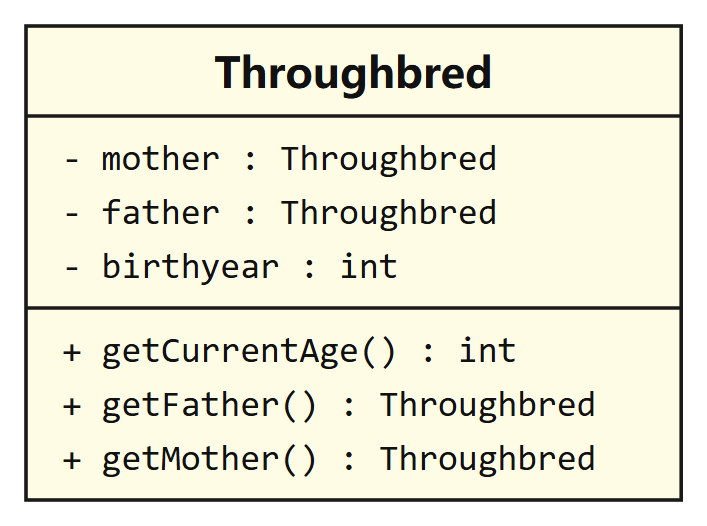
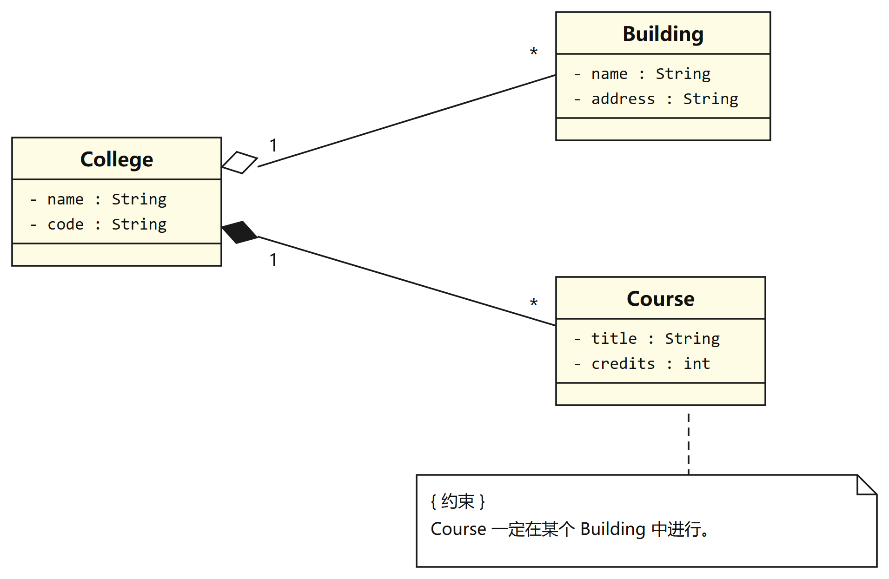
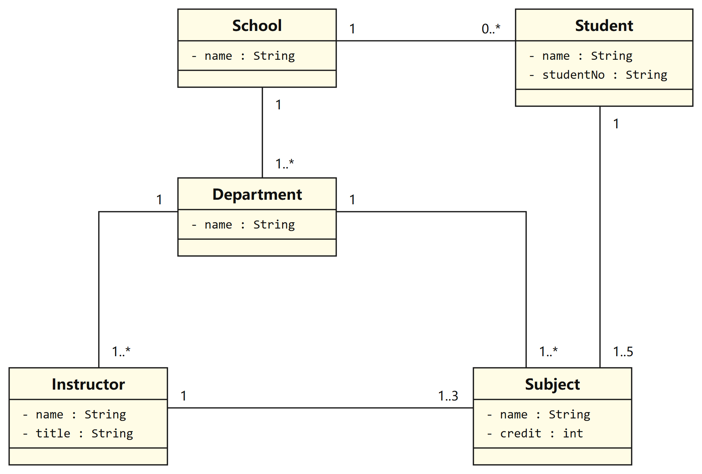
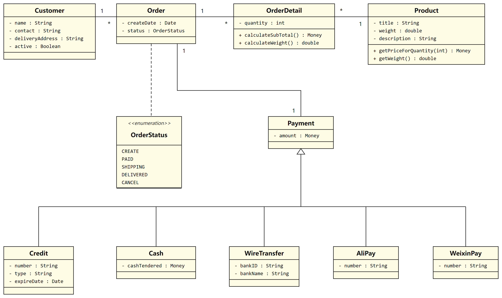

# 软件工程实验三 · 面向对象的系统建模 A

> 课程：软件工程　｜　学号：202410760155　｜　姓名：王应桐　｜　学院：计算机与信息学院

本仓库是《软件工程》实验三「面向对象的系统建模 A」的完整交付：四道建模题（A1-1 ~ A1-4）的 UML 类图，以及 A1-4「简化网上购物系统」的 Python 实现。

代码的作用是**验证模型而非实现业务系统**——每一个类、每一条关系都能在类图中找到对应，用来说明「类图不是画框，而是可以被代码校验的设计契约」。

---

## 一、实验题目与交付物

| 题号 | 题目 | 建模要点 | 交付物 |
|---|---|---|---|
| A1-1 | 优良品质马匹 `Throughbred` 类建模 | 3 个私有属性、3 个公有操作、可见性与类型标注 | 类图 |
| A1-2 | 学院、建筑与课程 | `College`—`Building` **聚合**、`College`—`Course` **组合**、约束注释 | 类图 |
| A1-3 | 学校、院系、教师、课程、学生 | 6 条关联、完整多重性（`1`、`0..*`、`1..*`、`1..3`、`1..5`） | 类图 |
| A1-4 | 简化网上购物系统 | 11 个类元素、`Payment` 泛化出 5 个支付子类、`«enumeration»` | 类图 + 代码 |

---

## 二、类图

### A1-1 Thoroughbred 类模型



`mother`、`father` 的类型都是 `Throughbred` 自身，因此该类隐含**自关联**语义：一匹马的对象持有另外两匹马的对象引用。本实验按题目要求用属性表达，若需强调这一结构，也可补一条两端都指向自身的关联线并标注角色名与多重性 `1`，但两种表达不应同时出现在同一张图中。

### A1-2 学院与建筑、课程的聚合 / 组合关系



| 关系 | 类型 | 图形符号 | 判据 |
|---|---|---|---|
| `College` — `Building` | 聚合 | 空心菱形（整体端） | 建筑可以不属于任何学院而独立存在 |
| `College` — `Course` | 组合 | 实心菱形（整体端） | 学院撤销后，其开设的课程不再有意义 |

`Course` 上挂了一条约束注释 `{ Course 一定在某个 Building 中进行 }`，用 note anchor 锚定到被约束的元素——这一点常被忽略，注释漂浮在图上等于没有约束。

### A1-3 学校组织结构的关联与多重性



| # | 关联 | 端点 A | 端点 B | 语义 |
|---|---|---|---|---|
| 1 | `School` — `Student` | `1` | `0..*` | 一个学院拥有零到多名学生 |
| 2 | `School` — `Department` | `1` | `1..*` | 一个学院至少下设一个系 |
| 3 | `Department` — `Instructor` | `1` | `1..*` | 一个系至少拥有一名指导教师 |
| 4 | `Department` — `Subject` | `1` | `1..*` | 一个系至少开设一门课程 |
| 5 | `Instructor` — `Subject` | `1` | `1..3` | 一名教师教授一至三门课程 |
| 6 | `Student` — `Subject` | `1` | `1..5` | 一名学生选修一至五门课程 |

多重性写在**被计数的那一端**：数值描述的是另一端的对象个数。校验方法是逐条反读——以第 3 条为例，从 `Department` 端读作「一个系拥有一到多名教师」，从 `Instructor` 端读作「一名教师属于且仅属于一个系」，与需求一致。

### A1-4 简化网上购物系统类模型



| 关系 | 类型 | 多重性 |
|---|---|---|
| `Customer` — `Order` | 关联 | `1 : *` |
| `Order` — `OrderDetail` | 组合 | `1 : *` |
| `OrderDetail` — `Product` | 关联 | `* : 1` |
| `Order` — `Payment` | 关联 | `1 : 1` |
| `Payment` ◁ `Credit` / `Cash` / `WireTransfer` / `AliPay` / `WeixinPay` | 泛化 | — |
| `Order` ⇢ `OrderStatus` | 依赖 | — |

`Payment` 为抽象类，五个子类属性各不相同但都具备「支付金额」并都需要对外提供支付行为，因此用泛化统一，运行时按实际类型多态调用。`OrderStatus` 的五个状态属于枚举型数据，用带 `«enumeration»` 构造型的类表达。

---

## 三、代码实现

### 目录结构

```
software-engineering-lab3/
├── demo.py                      # 多态结算演示，可直接运行
├── README.md
├── docs/
│   ├── uml/                     # 四张类图
│   └── report/                  # 实验报告
└── shopping_system/
    ├── __init__.py
    ├── order_status.py          # OrderStatus 枚举
    ├── product.py               # Product 商品项
    ├── order_detail.py          # OrderDetail 订单明细
    ├── payment.py               # Payment 抽象类 + 五个支付子类
    ├── order.py                 # Order 订单（组合 OrderDetail）
    └── customer.py              # Customer 客户（一对多 Order）
```

### 运行

```bash
python demo.py
```

要求 Python 3.10 及以上，仅使用标准库（`abc`、`enum`、`dataclasses` 无需额外安装）。

输出示例：

```
客户：王应桐（13800000000）
订单：SO20261107001　创建日期：2026-11-07
  1. 机械键盘   × 1　小计 ￥  399.00　重量 0.900 kg
  2. 无线鼠标   × 2　小计 ￥  258.00　重量 0.240 kg
合计金额 ￥657.00　总重量 1.140 kg
当前状态：CREATE
--------------------------------------------------------------
支付方式一览（多态调用 pay()）：
  信用卡 ***************5678（VISA，有效期至 2029-06）￥657.00 -> 成功
  现金（实收 ￥700.00，找零 ￥43.00）                        -> 成功
  在线转账（中国工商银行，账号 6228****4321）￥657.00        -> 成功
  支付宝（wyt@example.com）￥657.00                         -> 成功
  微信支付（wxid_wangyingtong）￥657.00                     -> 成功
--------------------------------------------------------------
结算结果：成功　订单状态：PAID
发货后状态：SHIPPING
签收后状态：DELIVERED
取消订单被拒绝：已发货订单不能直接取消
```

---

## 四、类图与代码的对应关系

| 模型元素 | 代码体现 |
|---|---|
| 私有属性 `- name : String` | `self._name` 实例变量 + `@property` 只读访问器 |
| 公有操作 `+ getWeight() : double` | `def get_weight(self) -> float` |
| 泛化（空心三角箭头） | `class Credit(Payment)` 继承 |
| 抽象类 `Payment` | `ABC` + `@abstractmethod pay()` |
| 组合 `Order` — `OrderDetail` | `Order` 内部以 `_details` 列表持有，并由 `add_item()` 创建 |
| 关联 `1 : *`（`Customer` — `Order`） | `Customer._orders: List[Order]` |
| 关联 `1 : 1`（`Order` — `Payment`） | `Order._payment: Optional[Payment]` |
| `«enumeration» OrderStatus` | `class OrderStatus(Enum)`，五个常量一一对应 |

---

## 五、设计要点

1. **多态替代分支判断**：结算时只调用 `payment.pay()`，不判断具体支付类型；新增一种支付方式只需增加一个子类，`Order` 与结算流程完全不必修改，体现开闭原则。
2. **组合的生命周期归属**：`OrderDetail` 只能由 `Order.add_item()` 创建并持有，订单支付后禁止再增删明细，与类图中组合关系的语义一致。
3. **状态迁移集中校验**：`OrderStatus` 的迁移集中在 `pay / ship / deliver / cancel` 四个方法中，非法迁移直接抛出异常，避免状态字段被任意改写。
4. **金额一致性校验**：`Order.pay()` 校验支付金额与订单总额相等，防止少付或多付。
5. **建模决策留痕**：需求未明说 `Order` 与 `OrderDetail` 是组合，本实现按「明细无独立业务身份」判为组合，若系统需要保留历史明细则应改为普通关联，这一取舍在实验报告 4.4.4 节有详细说明。

---

## 六、实验报告

完整报告见 [`docs/report/202410760155-王应桐-软件工程实验三.docx`](docs/report/202410760155-王应桐-软件工程实验三.docx)，包含封面、目录、实验目的与要求、四道题的建模过程（需求解析 → 元素确定 → 关系确定 → 模型绘制 → 结果校验）、建模问题与解决、实验结论及本仓库地址。

---

## 七、环境

| 项目 | 配置 |
|---|---|
| 操作系统 | Windows 11 家庭中文版 23H2 |
| 建模工具 | Rational Rose 2007 企业版（类图绘制与校验） |
| 代码实现 | Python 3.12 |
| 文档工具 | Microsoft Word 2021 |
| 代码托管 | GitHub |
